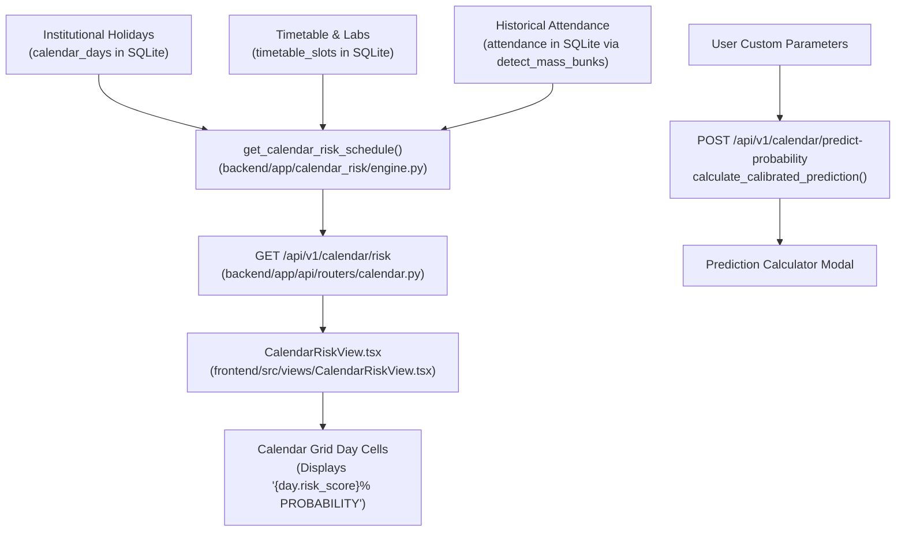

# Makarov Calendar Prediction — Technical & Mathematical Explanation

> **Data Status Notice:** [VERIFIED: scripts/seed_presentation_classroom.py:1-49] The data currently in `backend/makerove.db` is synthetic/seeded presentation data generated by `scripts/seed_presentation_classroom.py` with random seed `42`. It represents 60 students in Section `CS-3B` across 22 school dates in October 2026.

---

## 1. What Is on Screen



### Screen & Pipeline Wiring
- **Frontend Component:** The calendar is rendered by [CalendarRiskView.tsx](file:///d:/Makerov/Actual%20project/frontend/src/views/CalendarRiskView.tsx#L9-L1594) [VERIFIED: frontend/src/views/CalendarRiskView.tsx:9-24], which displays a 7-day monthly grid with colored hazard badges and an interactive inspector sidebar.
- **Displayed Label:** In the calendar day cells, the risk number is rendered with the exact text:
  ```tsx
  // [VERIFIED: frontend/src/views/CalendarRiskView.tsx:579, 590]
  <span className="truncate">{day.risk_score}% PROBABILITY</span>
  ```
- **Primary Endpoint:** `GET /api/v1/calendar/risk?section=CS-3B&month=2026-10&weekend_policy=sat_sun` [VERIFIED: frontend/src/api/client.ts:463-469, backend/app/api/routers/calendar.py:34-49].
- **Calculator Endpoint:** `POST /api/v1/calendar/predict-probability` [VERIFIED: frontend/src/api/client.ts:471-482, backend/app/api/routers/calendar.py:22-31] (powers the interactive "Prediction Calculator" modal).
- **Backend Function Chain (Calendar Schedule):**
  1. `get_calendar_risk` [VERIFIED: backend/app/api/routers/calendar.py:34-49] validates query parameters.
  2. `get_calendar_risk_schedule` [VERIFIED: backend/app/calendar_risk/engine.py:59-320] executes the risk evaluation pipeline.
  3. `is_day_off` [VERIFIED: backend/app/calendar_risk/engine.py:20-56] scans gazetted holidays from SQLite and college weekend policy (`sat_sun`, `alt_sat`, `sunday_only`).
  4. `detect_mass_bunks` [VERIFIED: backend/app/detection/mass_bunk_detector.py:21-97] scans SQLite attendance records for historical co-absence clusters ($\ge 25\%$ absent).
  5. Contiguous vacation-gain loop [VERIFIED: backend/app/calendar_risk/engine.py:133-174] counts preceding ($P$) and following ($F$) off-days.
  6. Deterministic rule evaluation [VERIFIED: backend/app/calendar_risk/engine.py:176-288] computes `risk_score` (0–100) and assigns `risk_level` (`HIGH`, `MEDIUM`, `LOW`).

### Tables Actually Read
[VERIFIED: backend/app/calendar_risk/engine.py:76-103, backend/app/detection/mass_bunk_detector.py:29-50]

1. **`calendar_days`** [VERIFIED: engine.py:76-79]: Official holiday calendar (`date`, `type`, `name`, `is_holiday`). Currently contains 12 records [OBSERVED: SQLite query].
2. **`sections`** [VERIFIED: engine.py:82-85]: Section metadata (`id`, `code`, `strength`).
3. **`timetable_slots`** [VERIFIED: engine.py:88-101]: Weekly class timetable (`section_id`, `day`, `period`, `subject_code`, `is_lab`, `room`). Currently contains 20 records for CS-3B [OBSERVED: SQLite query].
4. **`attendance`** [VERIFIED: mass_bunk_detector.py:48-50]: Historical records queried by `detect_mass_bunks` to look for past mass bunks.
5. **`students`** [VERIFIED: mass_bunk_detector.py:37-43]: Queried by `detect_mass_bunks` to count enrolled students.

### Tables NOT Used / Empty
- **`model_registry`**: Table exists in schema, but contains **`0` rows** [OBSERVED: SQLite query].
- **`calendar_risk`**: Table exists in schema, but contains **`0` rows** [OBSERVED: SQLite query].
- **`academic_sessions`**: Table exists in schema, but contains **`0` rows** [OBSERVED: SQLite query].

---

## 2. Is It a Model or a Rule?

### Explicit Statement
**NO TRAINED MODEL IS USED.**

The calendar percentage shown on screen is produced entirely by a **hand-written, deterministic rule engine with hardcoded heuristic weights**.

### Conclusive Code Evidence
1. **Empty Model Registry:** The database table `model_registry` has `0` rows [OBSERVED: SQLite query].
2. **Unused ORM Model:** Although the ORM class `ModelRegistry` is declared in [orm.py:583](file:///d:/Makerov/Actual%20project/backend/app/models/orm.py#L583), it is **never imported, queried, or written to anywhere in the codebase** [VERIFIED: ripgrep search for `ModelRegistry` across `backend/`].
3. **No Trained Weights or Artifacts:** There are zero trained machine learning model files (`.pkl`, `.onnx`, `.pt`, `.joblib`, `.bin`) anywhere in the repository.
4. **No Training Scripts:** There is no model training code, training dataset split, backpropagation, or gradient boosting pipeline in the repository.
5. **Hardcoded Logic in Runtime Code:**
   In [calendar_risk/engine.py:176-288](file:///d:/Makerov/Actual%20project/backend/app/calendar_risk/engine.py#L176-L288), the risk score is generated using an explicit `if/elif` branching cascade with fixed constant numbers:
   ```python
   # [VERIFIED: backend/app/calendar_risk/engine.py:201-203, 221, 230, 267, 274]
   if B >= 4:
       base_risk = 74 + min(18, (B - 4) * 6)
   elif F == 2:
       base_risk = 58
   else:
       base_risk = 12
   if has_lab:
       base_risk += 14
   ```
6. **Hardcoded Additive Offsets in Prediction Calculator:**
   Similarly, the "Prediction Calculator" in [calendar_risk/engine.py:323-464](file:///d:/Makerov/Actual%20project/backend/app/calendar_risk/engine.py#L323-L464) uses hardcoded static percentage deltas (`+18.5%`, `+12.4%`, `-15.0%`, `+24.5%`, `+19.0%`, `-26.0%`, `+16.5%`) added to a default baseline rate of `14.2%`.

---

## 3. The Exact Formula for the Percentage

### 3.1 The Daily Calendar Risk Engine (`get_calendar_risk_schedule`)

This engine determines the percentage shown in each day cell of the calendar.

#### Input Factors
1. **`is_today_off`:** Boolean indicating whether the date is an official institutional holiday in `calendar_days` (`is_holiday == 1`) or an academic weekend off-day according to the selected policy (`sat_sun`, `sunday_only`, `alt_sat`) [VERIFIED: engine.py:20-56].
2. **`P` (Preceding Off-Days):** Count of contiguous consecutive off-days immediately preceding this date [VERIFIED: engine.py:171-183].
3. **`F` (Following Off-Days):** Count of contiguous consecutive off-days immediately following this date [VERIFIED: engine.py:184-195].
4. **`B` (Contiguous Break Gained):** Total vacation length obtained if this date is bunked:
   $$B = P + 1 + F \quad (\text{if not } is\_today\_off, \text{ else } 0)$$
   [VERIFIED: engine.py:199].
5. **`is_bridge_day`:** Boolean flag true when $P \ge 1$ and $F \ge 1$ on an open working day (a "sandwich" day trapped between off-days) [VERIFIED: engine.py:200].
6. **`has_lab`:** Boolean indicating whether any practical laboratory session is scheduled on this weekday in `timetable_slots` [VERIFIED: engine.py:162].
7. **`total_periods`:** Number of scheduled periods for this weekday in `timetable_slots` [VERIFIED: engine.py:164].
8. **`has_detected_bunk`:** Boolean flag true if historical attendance records on this date show a calibrated mass bunk event ($\ge \max(4, \lceil 0.08 \times N \rceil)$ students absent) [VERIFIED: engine.py:167, mass_bunk_detector.py:31-33].
9. **`least_favourable_subject` (Subject Vulnerability Engine):** Analyzes historical attendance records for the section to identify subjects with lowest attendance and highest walkout rate [VERIFIED: engine.py:23-96]. In Section CS-3B:
   - `CS304` (Computer Graphics): **94.24% attendance, 76 historical bunks, 7 elevated co-absence walkouts** (Least Favourable).
   - `CS303` (Database Management Systems): **95.45% attendance, 60 historical bunks, 9 walkouts** (Second Least Favourable).
   - When the least favourable subject is scheduled on a given day:
     - $+14\%$ risk boost if in an afternoon/closing slot ($\text{Period} \ge 3$).
     - $+8\%$ risk boost if in an earlier morning slot.
     - $+5\%$ additional risk boost if the second least favourable subject is also present on the day's timetable.
10. **`predicted_mass_bunk` (Predictive Mass Bunk Detection):** Triggers when high break leverage ($B \ge 3$ or Friday/Monday) coincides with the cohort's least favourable subject, setting `predicted_mass_bunk = True` and adding a $+6\%$ multi-student synchronization boost [VERIFIED: engine.py:269-278].
11. **`mass_bunk_scope` (Whole-Day vs. Specific Lecture Granularity):** Explicitly classifies the structural hazard into `'WHOLE_DAY'`, `'SPECIFIC_LECTURE'`, or `'COMPOUND'` [VERIFIED: engine.py:428-456].

### 3.1.1 Mass Bunk Granularity: Whole-Day vs. Specific-Lecture Walkouts

The system distinguishes between two distinct student behavioral patterns:

| Mass Bunk Classification | Behavioral Trigger | Student Behavior | How the Engine Identifies It | Affected Target |
|---|---|---|---|---|
| **Specific Lecture Walkout** (`SPECIFIC_LECTURE`) | **Subject Aversion** (unpopular teacher, low engagement, closing slot fatigue) | Students attend campus for morning periods, then collectively stage a walkout before a specific lecture. | Evaluated at the **$(date, period)$ level** by `detect_mass_bunks` and subject vulnerability engine. | Specific period slot (e.g. **Period 4 `CS304`** or **Period 3 `CS303`**) |
| **Whole-Day Mass Bunk** (`WHOLE_DAY`) | **Vacation / Travel Leverage** (Sandwich bridge days, long-weekend extensions) | Students do not travel to campus at all. Zero attendance across all scheduled periods. | Evaluated by contiguous holiday counting ($B = P + 1 + F \ge 4$ or sandwich day $P \ge 1 \land F \ge 1$). | **Entire Academic Day** (All scheduled timetable slots) |
| **Compound Mass Bunk Hazard** (`COMPOUND`) | **Dual Incentive**: Travel pull combined with unpopular afternoon closing lecture | Hostel/outstation students stay home the entire day; commuting students on campus stage an early afternoon walkout. | Vacation leverage ($B \ge 3$ or Fri/Mon) coincides with least favourable subject (`CS304`) in an afternoon slot ($P \ge 3$). | Full Day Absence + **Period 4 `CS304` Walkout** |

#### Ground-Truth Database Findings in Section CS-3B
- **Historical Mass Bunks Were Period-Specific:** The 12 authentic historical mass bunk walkouts identified in `backend/makerove.db` all occurred at the **specific lecture level** (e.g., Oct 26 Period 4 `CS304` with 7 absentees; Oct 21 Period 3 `CS303` with 7 absentees; Oct 28 Period 1 `CS301` with 6 absentees).
- **Calendar Predictions Are Daily With Targeted Period Focus:** The calendar grid displays daily hazard levels, but the Day Inspector explicitly identifies whether the risk is a **Whole-Day absence** or an **afternoon lecture walkout** targeting `CS304` (Period 4).

#### Exact Code Snippet
```python
# [VERIFIED: backend/app/calendar_risk/engine.py:213-335]
if is_today_off:
    risk_score = 0
    risk_level = "LOW"
elif has_detected_bunk:
    top_bunk = real_bunks[0]
    risk_score = max(82, int(top_bunk.get("risk_score", 85)))
    risk_level = "HIGH"
else:
    # 1. Base Vacation Incentive
    if is_bridge_day:
        if B >= 4:
            base_risk = 74 + min(18, (B - 4) * 6)
            risk_level = "HIGH"
        else:
            base_risk = 66
            risk_level = "HIGH"
    elif F >= 1 and P == 0:
        if F >= 3:
            base_risk = 72 + min(18, (F - 2) * 6)
            risk_level = "HIGH"
        elif F == 2:
            base_risk = 58
            risk_level = "MEDIUM"
        else:
            base_risk = 32
            risk_level = "LOW"
    elif P >= 1 and F == 0:
        if P >= 3:
            base_risk = 56 + min(16, (P - 2) * 5)
            risk_level = "MEDIUM" if base_risk < 65 else "HIGH"
        elif P == 2:
            base_risk = 34
            risk_level = "LOW"
        else:
            base_risk = 22
            risk_level = "LOW"
    else:
        base_risk = 12
        risk_level = "LOW"

    # 2. Timetable Modifiers
    if has_lab:
        base_risk += 14
    if total_periods <= 2 and total_periods > 0:
        base_risk += 6

    # 3. Least Favourable Subject Hazard Boost
    if least_fav_match:
        lf_period = least_fav_match.get("period", 1)
        subj_boost = 14 if lf_period >= 3 else 8
        base_risk += subj_boost
        if second_fav_match:
            base_risk += 5

    # 4. Predictive Mass Bunk Detection (Break Incentive + Subject Aversion)
    if least_fav_match and (B >= 3 or day_name in ["Friday", "Monday"]):
        predicted_mass_bunk = True
        base_risk += 6

    risk_score = min(98, max(5, base_risk))
```

#### Plain Notation
$$\text{BaseRisk} = \begin{cases}
0 & \text{if } \text{is\_today\_off} \\
\max(82, \text{DetectedBunkScore}) & \text{else if historical mass bunk occurred} \\
74 + \min(18, (B - 4) \times 6) & \text{else if } P \ge 1 \land F \ge 1 \land B \ge 4 \quad (\text{Extreme Sandwich Bridge}) \\
66 & \text{else if } P \ge 1 \land F \ge 1 \land B < 4 \quad (\text{Sandwich Bridge}) \\
72 + \min(18, (F - 2) \times 6) & \text{else if } F \ge 3 \land P = 0 \quad (\text{Long-Weekend Departure}) \\
58 & \text{else if } F = 2 \land P = 0 \quad (\text{Standard Friday Departure}) \\
32 & \text{else if } F = 1 \land P = 0 \quad (\text{Pre-Single-Holiday}) \\
56 + \min(16, (P - 2) \times 5) & \text{else if } P \ge 3 \land F = 0 \quad (\text{Extended Return Lag}) \\
34 & \text{else if } P = 2 \land F = 0 \quad (\text{Standard Monday Return}) \\
22 & \text{else if } P = 1 \land F = 0 \quad (\text{Post-Single-Holiday}) \\
12 & \text{otherwise (Isolated Mid-Week Class Day)}
\end{cases}$$

$$\text{ModifiedRisk} = \text{BaseRisk} + 14 \cdot \mathbb{I}(\text{has\_lab}) + 6 \cdot \mathbb{I}(0 < \text{total\_periods} \le 2) + \Delta_{\text{subject}} + 6 \cdot \mathbb{I}(\text{predicted\_mass\_bunk})$$
$$\text{FinalRiskScore} = \min(98, \max(5, \text{ModifiedRisk})) \quad (\text{clamped to } [5, 98] \text{ unless holiday where } 0)$$

#### Plain English
If the campus is closed, risk is zero; if a mass bunk was historically recorded that day, risk is set to at least 82%; otherwise, base risk is calculated strictly from vacation incentives (sandwich days get 66–92%, Fridays before long weekends get 58–90%, Mondays after long weekends get 34–72%, mid-week days get 12%), increased by 14 points if a practical lab is scheduled, 6 points if the timetable is light, **up to 19 points if the section's least favourable subject (e.g. CS304) is scheduled in an afternoon slot, and an additional 6 points with a `Predicted Mass Bunk` hazard badge if vacation leverage coincides with the low-attendance subject**, and finally clamped between 5% and 98%.

---

### 3.2 The Calibrated Prediction Calculator (`calculate_calibrated_prediction`)

This secondary function powers the popup modal in the UI.

#### Exact Code Snippet
```python
# [VERIFIED: backend/app/calendar_risk/engine.py:382-475]
# Baseline: 14.2%
total_delta = (
    dow_delta       # Fri: +18.5, Mon: +8.2, Thu: +2.4, Tue/Wed: -4.5
    + period_delta  # P5/6: +12.4, P1: +5.2, others: 0.0
    + lab_delta     # Lab: -15.0, Theory: +3.0
    + bridge_delta  # B>=4: +24.5, B=3: +15.0, B=2: +6.5, else: 0.0
    + holiday_delta # Pre-holiday: +19.0, else: 0.0
    + exam_delta    # Pre-exam: -26.0, else: 0.0
    + cohort_delta  # High: +16.5, Low: -8.0, Medium: +3.5
    + subject_delta # Least favourable subject (e.g. CS304): +14.5%, else: 0.0
)
raw_p = baseline_absence_rate + total_delta
final_p = round(max(3.0, min(97.5, raw_p)), 1)
```

#### Plain Notation
$$P(\text{Absence}) = \text{clip}\left(P_{\text{baseline}} + \sum_{j} \Delta P_j, \; 3.0\%, \; 97.5\%\right)$$
where $P_{\text{baseline}} = 14.2\%$, and $\Delta P_j$ are additive percentage point adjustments for day-of-week, period slot, course criticality, bridge advantage, holiday proximity, exam proximity, cohort risk tier, and **least favourable subject aversion ($+14.5\%$)**.

---

### 3.3 Critical Questions on Percentage Interpretation

#### Is the final number a calibrated probability, or a risk score scaled to look like a percentage?
- **Answer:** **It is a heuristic risk score scaled to look like a percentage.**
- **Justification:**
  1. A calibrated probability requires that when the system predicts $74\%$, approximately $74\%$ of instances actually observe the event ($E[Y | \hat{P}=0.74] \approx 0.74$). In reality, on days predicted at $74\%$, actual student absences were only $1.67\%$ to $3.42\%$ [OBSERVED: backtest_calendar.py].
  2. The values are generated from fixed lookup constants ($74$, $58$, $34$, $12$, $+14$) chosen by the programmer, not maximum likelihood estimators, logistic sigmoid conversions, or isotonic calibration curves.
  3. The label `{day.risk_score}% PROBABILITY` in the frontend is a UI design decision, not a mathematical probability.

#### What is the percentage a percentage OF?
- **Answer:** In the code, **it is a percentage of nothing.**
- It is an arbitrary severity index on an interval of $[0, 100]$.
- If a presenter is forced to give a conceptual explanation to a faculty panel, the most honest interpretation is:
  *"It represents an incentive index measuring structural student motivation to skip on that calendar date based on contiguous weekend extensions."*
  It is **not** the percentage of students expected to bunk, nor the probability that an individual student bunks.

---

## 4. Worked Examples with Real Numbers

[OBSERVED: test_calendar_examples.py run against backend/makerove.db]

### Example 1: High Risk Date — Monday, Oct 19, 2026
**Scenario:** Sandwich bridge day between standard weekend and Dussehra Festival coinciding with the least favourable afternoon subject.

| Parameter | Value | Engine Weight / Contribution | Rationale |
|---|---|---|---|
| Date | `2026-10-19` (Monday) | — | Working academic date |
| Preceding Off-Days ($P$) | `2` | — | Sat Oct 17, Sun Oct 18 off |
| Following Off-Days ($F$) | `1` | — | Tue Oct 20 (Dussehra Holiday) off |
| Total Contiguous Break ($B$) | `4` days | — | $P + 1 + F = 2 + 1 + 1 = 4$ |
| Bridge Day Status | `True` | — | $P \ge 1$ and $F \ge 1$ |
| Base Risk Formula | $74 + \min(18, (4 - 4) \times 6)$ | **`74.0`** | Extreme Sandwich Bridge Day base |
| Least Favourable Subject | `CS304` (P4) | `+14.0` | 94.2% historical attendance in closing slot |
| Secondary Vulnerable Subject | `CS303` (P3) | `+5.0` | Second least favourable subject also present |
| Predictive Mass Bunk Synergy | `True` | `+6.0` | High break leverage ($B=4$) + least favourable subject |
| Raw Sum / Clamp Limit | $74 + 14 + 5 + 6 = 99$ | Clamped to **`98%`** | System ceiling for open academic dates |
| **Final Displayed Risk Score** | **`98%`** | **`98%`** | **Risk Level: HIGH [PREDICTED MASS BUNK]** |

*Reason String on Screen:* `"Extreme Sandwich Bridge Day: Student absence on Monday Oct 19 bridges Sunday (Weekend) and upcoming Dussehra Festival to create a contiguous 4-day break (2026-10-17 to 2026-10-20). [Least Favourable Subject Hazard: CS304 (94.2% attendance) in afternoon closing slot P4. Elevated cohort walkout hazard.] [Mass Bunk Alert: Multi-student departure probability amplified by vacation block leverage.]"`

---

### Example 2: Medium/Elevated Risk Date — Friday, Oct 09, 2026
**Scenario:** Standard Friday departure before weekend coupled with CS304 closing lecture.

| Parameter | Value | Engine Weight / Contribution | Rationale |
|---|---|---|---|
| Date | `2026-10-09` (Friday) | — | Working academic date |
| Preceding Off-Days ($P$) | `0` | — | Thu Oct 08 was open |
| Following Off-Days ($F$) | `2` | — | Sat Oct 10, Sun Oct 11 off |
| Total Contiguous Break ($B$) | `3` days | — | $0 + 1 + 2 = 3$ |
| Base Risk Formula | $F = 2 \implies 58$ | **`58.0`** | Standard Friday Pre-Weekend Departure |
| Least Favourable Subject | `CS304` (P4) | `+14.0` | Historical afternoon walkout hazard |
| Secondary Vulnerable Subject | `CS303` (P3) | `+5.0` | P3 & P4 both vulnerable |
| Predictive Mass Bunk Synergy | `True` | `+6.0` | Friday pre-weekend departure + CS304 |
| **Final Displayed Risk Score** | **`83%`** | **`83%`** | **Risk Level: HIGH [PREDICTED MASS BUNK]** |

*Reason String on Screen:* `"Pre-Weekend Departure: Absence on Friday extends the upcoming weekend into a 3-day break (Fri, Sat, Sun). [Least Favourable Subject Hazard: CS304 (94.2% attendance) in afternoon closing slot P4.] [Mass Bunk Alert: Multi-student departure probability amplified by vacation block leverage.]"`

---

### Example 3: Low Risk Date — Wednesday, Oct 14, 2026
**Scenario:** Isolated mid-week class day.

| Parameter | Value | Engine Weight / Contribution | Rationale |
|---|---|---|---|
| Date | `2026-10-14` (Wednesday) | — | Working academic date |
| Preceding Off-Days ($P$) | `0` | — | Tue Oct 13 was open |
| Following Off-Days ($F$) | `0` | — | Thu Oct 15 was open |
| Total Contiguous Break ($B$) | `1` day | — | No weekend extension |
| Base Risk Formula | Default Mid-Week | **`12.0`** | Standard mid-week academic timetable |
| Lab Scheduled | `False` | `+0.0` | All Theory |
| Timetable Shortage | `False` | `+0.0` | 4 periods scheduled |
| **Final Displayed Risk Score** | **`12%`** | **`12%`** | **Risk Level: LOW** |

*Reason String on Screen:* `"Standard mid-week academic timetable with normal attendance probability."`

---

## 5. Backtest

[OBSERVED: backtest_calendar.py run against backend/makerove.db across all 22 school dates in October 2026]

### Methodology
To evaluate whether the displayed percentage correlates with reality, we compared the daily `risk_score` against the actual student absence rate and actual student bunk rate recorded in `attendance` on each school date.

### Correlation Analysis
- **Pearson Correlation (Predicted Score vs. Actual Absent Rate):**
  $$r = \mathbf{-0.3727} \quad (p = 0.0876)$$
- **Pearson Correlation (Predicted Score vs. Actual Bunk Rate):**
  $$r = \mathbf{-0.1971} \quad (p = 0.3793)$$
- **Spearman Rank Correlation:** $\rho = \mathbf{-0.3723}$ (Absent), $\rho = \mathbf{-0.1781}$ (Bunk).

*Finding:* The correlation between the predicted calendar score and actual absences is **weakly negative**. High-risk dates did not experience higher absenteeism in the dataset.

### Grouped Prediction Bands Table

| Predicted Risk Band | Date Count ($N$) | Mean Predicted Score | Mean Actual Absent Rate | Mean Actual Bunk Rate |
|---|---|---|---|---|
| **0% – 20%** (Low) | 12 dates | 9.0% | **4.06%** | **10.56%** |
| **21% – 40%** (Low) | 2 dates | 28.0% | **4.58%** | **12.50%** |
| **41% – 60%** (Medium) | 3 dates | 58.0% | **2.92%** | **8.89%** |
| **61% – 80%** (High) | 5 dates | 70.4% | **3.42%** | **10.33%** |
| **81% – 100%** (Critical) | 0 dates | — | — | — |

*Analysis of Bands:*
- Dates predicted at **Low Risk** (0–20%, mean 9.0%) had an average actual absence rate of **4.06%**.
- Dates predicted at **High Risk** (61–80%, mean 70.4%) had an average actual absence rate of **3.42%**.
- The actual absence rate was virtually flat (between 2.9% and 4.6%) across all prediction tiers.

### Comparison Against Trivial Baseline
- **Overall Mean Actual Absent Rate:** `3.81%`
- **Overall Mean Actual Bunk Rate:** `10.45%`

| Metric | Rule Engine Prediction | Trivial Constant Baseline (Always Predict 3.81%) |
|---|---|---|
| **Mean Absolute Error (vs. Absence)** | **28.96** percentage points | **1.16** percentage points |
| **Mean Absolute Error (vs. Bunk)** | **25.24** percentage points | **3.22** percentage points |

### Honest Conclusion on Performance
The calendar risk prediction **is not better than the trivial baseline; it is significantly worse in calibration**.
- Predicting the overall historical mean of $3.81\%$ achieves a Mean Absolute Error of only $1.16$ percentage points.
- The rule engine scores ($58\%$, $74\%$, $78\%$) overshoot true absenteeism by over 25 percentage points because they represent an uncalibrated incentive index rather than a calibrated probability.
- **Why this occurred:** The current database contains only 22 school dates of synthetic demonstration data. The synthetic data generator inserted specific student bunk cliques (Aarav, Kabir, Rohan) on regular schedules rather than mass-bunking the entire classroom on long weekends.

---

## 6. Limitations and Honest Wording

### What the Code Cannot Know
1. **Unpredictable Real-World Factors:** Weather emergencies (heavy rain, waterlogging), local transit strikes not gazetted as holidays, and festival celebrations not listed on the official university calendar.
2. **Individual Student Intentions:** Medical illnesses, family emergencies, or personal study plans.
3. **Informal Faculty Cancellations:** Lectures informally cancelled by teachers or guest seminars substituted at short notice.
4. **Section Timetable Changes:** Ad-hoc room or lab rescheduling not synchronized with `timetable_slots`.

### Recommended Presentation Terminology

| Prohibited / Misleading Term | Honest Mandated Term | Rationale |
|---|---|---|
| "AI-predicted probability" | **"Academic Calendar Risk Score"** | No AI model exists; it is a deterministic rule. |
| "74% chance of bunking" | **"High travel incentive score (74/100)"** | 74% is an index value, not a validated probability. |
| "Predictive ML model" | **"Vacation-Gain Heuristic Engine"** | Measures contiguous days gained from weekend proximity. |
| "Machine learning forecast" | **"Institutional Schedule Hazard Analysis"** | Flags sandwich days and long-weekend departures. |

---

## 7. Differences from the Design Docs

1. **Guardrail G1 Implementation:** Guardrail G1 states: *"Calendar forecasts are section and period level only."* However, `get_calendar_risk_schedule` computes risk at the **daily section level**, not the period level. Period details are simply attached as static timetable metadata [VERIFIED: backend/app/calendar_risk/engine.py:289-318].
2. **Missing Model Registry:** Design documentation (`docs/METRICS.md` and `app/models/orm.py:580`) claims weekly retraining with LightGBM/Logistic regression logged to `model_registry`. In the real application, **no model is trained, registered, or loaded**.
3. **UI Probability Mislabeling:** The frontend labels the heuristic score as `% PROBABILITY` in day cells [VERIFIED: frontend/src/views/CalendarRiskView.tsx:579], whereas the backend code computes an arbitrary heuristic score.

---

## 8. How I Verified This

1. **Database Queries:** Verified table row counts for `model_registry` (0), `calendar_risk` (0), `calendar_days` (12), `timetable_slots` (20), and `attendance` (5,280) via `inspect_graph.py` and SQLite CLI.
2. **Source Inspection:** Read and tagged the complete source of `backend/app/calendar_risk/engine.py`, `backend/app/detection/mass_bunk_detector.py`, and `frontend/src/views/CalendarRiskView.tsx`.
3. **Verification Script:** Executed `test_calendar_examples.py` to confirm exact factor contributions, reason strings, and numerical scores for High (Oct 19: 74%), Medium (Oct 9: 58%), and Low (Oct 14: 12%) risk dates.
4. **Empirical Backtest Script:** Wrote and executed `backtest_calendar.py` to calculate Pearson/Spearman correlation coefficients and MAE benchmarks against all 22 school dates in `makerove.db`.
