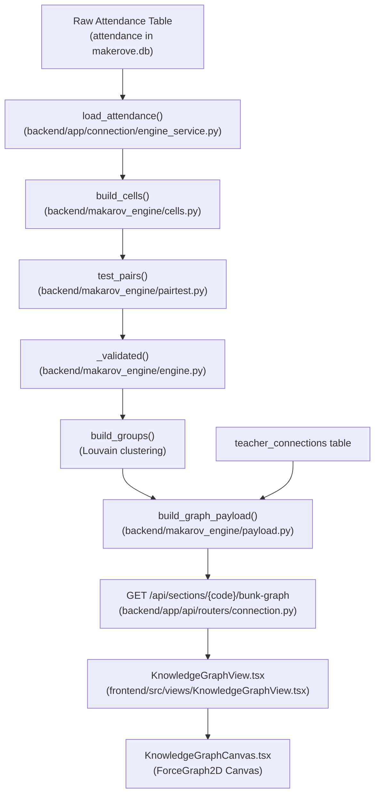

# Makarov Knowledge Graph — Technical & Mathematical Explanation

> **Data Status Notice:** [VERIFIED: scripts/seed_presentation_classroom.py:1-49] The data currently in `backend/makerove.db` is synthetic/seeded presentation data generated by `scripts/seed_presentation_classroom.py` with random seed `42`. It represents 60 students in Section `CS-3B` across 22 school dates in October 2026.

---

## 1. What Is on Screen



### Screen & Pipeline Wiring
- **Frontend Component:** The interactive network is drawn by [KnowledgeGraphView.tsx](file:///d:/Makerov/Actual%20project/frontend/src/views/KnowledgeGraphView.tsx#L49-L1039) [VERIFIED: frontend/src/views/KnowledgeGraphView.tsx:49], which embeds the HTML5 Canvas renderer [KnowledgeGraphCanvas.tsx](file:///d:/Makerov/Actual%20project/frontend/src/components/knowledge-graph/KnowledgeGraphCanvas.tsx#L12-L621) [VERIFIED: frontend/src/components/knowledge-graph/KnowledgeGraphCanvas.tsx:12-25].
- **API Endpoint:** The frontend calls `GET /api/sections/{code}/bunk-graph` via `api.getBunkGraph(currentSection, ...)` [VERIFIED: frontend/src/api/client.ts:647-670, frontend/src/views/KnowledgeGraphView.tsx:130-135].
- **Backend Function Chain:**
  1. `get_section_bunk_graph` [VERIFIED: backend/app/api/routers/connection.py:240-294] handles the HTTP route and checks access.
  2. `compute_graph` [VERIFIED: backend/app/connection/engine_service.py:374-427] manages data versioning, in-memory cache lookup (`_ENGINE_CACHE`), database fetching, and engine execution.
  3. `load_attendance` [VERIFIED: backend/app/connection/engine_service.py:78-129] pulls attendance records from SQLite and canonicalizes statuses.
  4. `run_engine` [VERIFIED: backend/makarov_engine/engine.py:91-118] coordinates cell grid construction, pair hypothesis testing, edge validation, and Louvain group assignment.
  5. `build_cells` [VERIFIED: backend/makarov_engine/cells.py:37-189] filters exclusions and maps rows into dense boolean matrices.
  6. `test_pairs` [VERIFIED: backend/makarov_engine/pairtest.py:52-97] runs stratified hypergeometric convolution tests and Benjamini-Hochberg FDR adjustments.
  7. `_validated` [VERIFIED: backend/makarov_engine/engine.py:30-41] filters candidates by statistical and effect-size thresholds.
  8. `build_groups` [VERIFIED: backend/makarov_engine/engine.py:70-89] executes Louvain modularity clustering on validated edges.
  9. `build_graph_payload` [VERIFIED: backend/makarov_engine/payload.py:13-126] merges validated bunk edges with teacher manual connections (`teacher_connections` table) and returns JSON.

### Engine Source: Legacy vs. Current
- **Explicit Statement:** [VERIFIED: backend/app/graph/, backend/makarov_engine/] The graph on screen **comes 100% from `makarov_engine` (`run_engine` and `build_graph_payload`)**.
- The directory `backend/app/graph/` contains only `__pycache__`. The legacy files `app/graph/graph_engine.py` and `statistical_derivation.py` mentioned in old documentation were removed in commit `ba82209` (Oct 11, 2026) and do not exist in the working tree.

---

## 2. Inputs

### Tables & Columns Read
1. **`attendance`** [VERIFIED: backend/app/connection/engine_service.py:97-120]:
   - Columns read: `id`, `student_id`, `roll_no`, `date`, `period`, `subject_code`, `status`.
   - Joined to `students` via `attendance.student_id == students.id` to resolve `roll_no` when `attendance.roll_no` is null [VERIFIED: backend/app/connection/engine_service.py:106-111].
2. **`students`** [VERIFIED: backend/app/connection/engine_service.py:81-90, 403]:
   - Columns read: `id`, `roll_no`, `name`, `section_id`, `section_code`.
3. **`sections`** [VERIFIED: backend/app/connection/engine_service.py:84-86]:
   - Columns read: `id`, `code`.
4. **`teacher_connections`** [VERIFIED: backend/app/connection/engine_service.py:341-352]:
   - Columns read: `id`, `section_code`, `student_a`, `student_b`, `connection_type`, `weight`, `notes`, `created_by`, `created_at`.
5. **Optional / Overlay Tables (queried by loaders, currently 0 rows in DB)**:
   - `session_events` [VERIFIED: backend/app/connection/engine_service.py:132-154] (cancelled periods).
   - `leaves` [VERIFIED: backend/app/connection/engine_service.py:171-193] (medical/on-duty leaves).
   - `membership_ties` [VERIFIED: backend/app/connection/engine_service.py:210-234] (clubs, transport, seating).
   - `peer_nominations` [VERIFIED: backend/app/connection/engine_service.py:251-278] (sociometric surveys).
   - `edge_dismissals` [VERIFIED: backend/app/connection/engine_service.py:295-316] (teacher dismissals).

### Database Counts for CS-3B
- **Total Enrolled Students:** `60` [OBSERVED: inspect_graph.py]
- **Total Attendance Rows:** `5,280` [OBSERVED: inspect_graph.py]
- **Distinct Dates in Register:** `22` (from `2026-10-01` to `2026-10-30`, excluding weekends and holidays) [OBSERVED: inspect_graph.py]
- **Status Breakdown:**
  - `PRESENT`: `5,079` rows (`96.19%`) [OBSERVED: inspect_graph.py]
  - `ABSENT`: `201` rows (`3.81%`) [OBSERVED: inspect_graph.py]
- **Share of Attendance Rows ABSENT:** Exactly **`3.81%`** (`201 / 5,280`) [OBSERVED: inspect_graph.py].

---

## 3. How One "Bunk" Is Defined

### Exact Rule
In Makarov, a student cannot "bunk" if they never came to campus that day. An absent row is only a bunk if the student was demonstrably on campus for at least one other period on that same calendar date.

```python
# [VERIFIED: backend/makarov_engine/cells.py:104, 138-140]
df["present"] = df["status"].isin(["PRESENT", "LATE"])
on_campus = df["n_present"] >= 1                       # full-day absences are not bunks and not eligible
df["exp_row"] = on_campus & ~df["excused"] & ~df["late_arrival"]
df["bunk_row"] = df["exp_row"] & df["absent"]
```

```python
# [VERIFIED: backend/makarov_engine/cells.py:155-157]
agg = (dff.groupby(["roll_no", "date", "block"], sort=False)
          .agg(elig=("exp_row", "any"), bunk=("bunk_row", "any")).reset_index())
agg = agg[agg["elig"]]
```

### Plain Notation
$$\text{OnCampus}(i, d) = \left(\sum_{p} \mathbb{I}(\text{status}_{i,d,p} \in \{\text{PRESENT}, \text{LATE}\})\right) \ge 1$$
$$\text{EligibleRow}(i, d, p) = \text{OnCampus}(i, d) \land \neg \text{Excused}(i, d, p) \land \neg \text{LateArrival}(i, d, p)$$
$$\text{BunkRow}(i, d, p) = \text{EligibleRow}(i, d, p) \land (\text{status}_{i,d,p} == \text{ABSENT})$$
$$\text{CellBunk}(i, d, b) = \bigvee_{p \in \text{Block}_b} \text{BunkRow}(i, d, p)$$

### Plain English
A student is credited with a bunk in a morning or afternoon timetable block if and only if they were present on campus for at least one period that day, had no approved medical or duty leave, did not arrive late in the morning, and were marked absent in at least one scheduled period of that block.

### Exclusions & Thresholds
1. **Full-Day Absence Exclusion:** If `n_present == 0` for the entire date, the student was sick or off campus. All rows for that day are marked `exp_row = False` and `bunk_row = False` [VERIFIED: backend/makarov_engine/cells.py:138].
2. **Approved Leave Exclusion:** Any row covered by an active date range in `leaves` table (`MEDICAL_LEAVE` or `ON_DUTY`) is normalized to an excused status and excluded from bunks and eligibility [VERIFIED: backend/makarov_engine/cells.py:78-90, 106, 139].
3. **Cancelled Class Exclusion:** Any date or `(date, period)` listed in `session_events` as `CANCELLED` or `TEACHER_ABSENT` is dropped before cell aggregation [VERIFIED: backend/makarov_engine/cells.py:65-75].
4. **Late Arrival Exclusion:**
   - **Code:**
     ```python
     # [VERIFIED: backend/makarov_engine/cells.py:129-134]
     lead = df["cum_present"] == 0
     n_lead = lead.groupby(keys).transform("sum")
     late = lead & df["absent"] & (n_lead <= cfg.late_arrival_max_periods) & (df["n_present"] >= 1)
     if cfg.treat_late_arrival_as_bunk:
         late = pd.Series(False, index=df.index)
     df["late_arrival"] = late
     ```
   - **Threshold:** `late_arrival_max_periods: int = 2` [VERIFIED: backend/makarov_engine/config.py:23].
   - **Effect:** Being absent for periods 1 or 1–2 and present in period 3+ is classified as commuting tardiness, not a deliberate bunk. (In the current database, exactly `36` rows were excluded as late arrivals [OBSERVED: inspect_graph.py]).
5. **Class-Wide Mass Skip Exclusion:**
   - **Code:**
     ```python
     # [VERIFIED: backend/makarov_engine/cells.py:160-166]
     cell_tot = agg.groupby(["date", "block"]).agg(n_elig=("elig", "sum"), n_bunk=("bunk", "sum")).reset_index()
     cell_tot["rate"] = cell_tot["n_bunk"] / cell_tot["n_elig"]
     cell_tot["mass"] = (cell_tot["n_elig"] >= cfg.mass_cell_min_students) & (cell_tot["rate"] >= cfg.mass_cell_threshold)
     ```
   - **Thresholds:** `mass_cell_threshold: float = 0.40` (40% of on-campus students), `mass_cell_min_students: int = 8` [VERIFIED: backend/makarov_engine/config.py:29-31].
   - **Effect:** When 40% or more of the class skips together (college fest, transport strike, informal cancellation), that cell is excluded from pairwise tie inference because it reflects a collective event, not private affinity.
6. **Data Sufficiency Gates:**
   - `min_school_dates: int = 15` [VERIFIED: backend/makarov_engine/config.py:35]. If distinct dates `< 15`, aborts with `INSUFFICIENT_DATA`.
   - `min_multi_period_share: float = 0.50` [VERIFIED: backend/makarov_engine/config.py:38]. If fewer than 50% of student-days have $\ge 2$ observed periods, aborts with `PERIOD_DATA_REQUIRED`.

---

## 4. How Two Students Get Connected

### (a) What Is Counted ("Co-bunk")
- A co-bunk is **not** defined by single periods, nor by whole days.
- It is defined by a **timetable block** on a single date:
  - `blocks = ((1, 4), (5, 8))` [VERIFIED: backend/makarov_engine/config.py:18].
  - Block 0: Periods 1 through 4 (Morning).
  - Block 1: Periods 5 through 8 (Afternoon).
- **Why blocks?** A student who leaves campus at 1:00 PM is absent in 4 consecutive periods. Counting those as 4 independent events would treat one shared decision as 4 statistical coincidences. One block equals one decision to skip [VERIFIED: backend/makarov_engine/config.py:13-17].
- A co-bunk occurs when Student A and Student B both have `bunk == True` on the exact same date and block index:
  $$c_{obs} = \sum_{k=1}^{K} Y_{A, k} \cdot Y_{B, k}$$

### (b) Exact Mathematical Formulas
Every tested pair belongs to one or more timetable strata.
Strata are formed by the combination of day-of-week and time block:
$$\text{stratum} = \text{weekday} \times 10 + \text{block} \quad (\text{e.g., Friday Block 0 = } 40)$$

#### 1. Observed Overlap Count ($c_{obs}$)
- **Code:**
  ```python
  # [VERIFIED: backend/makarov_engine/pairtest.py:67]
  c_tot = Ya @ Ya.T
  ```
- **Formula:** $c_{obs} = \mathbf{Y}_A \cdot \mathbf{Y}_B = \sum_{k} (Y_{A,k} \cdot Y_{B,k})$
- **English:** The total number of shared half-day timetable blocks where both students were on campus and both chose to skip.

#### 2. Expected Overlap Under Stratified Null ($\mathbb{E}[C]$)
- **Code:**
  ```python
  # [VERIFIED: backend/makarov_engine/pairtest.py:44]
  expected += a * b / n
  ```
- **Formula:**
  $$\mathbb{E}[C] = \sum_{s \in \text{Strata}} \frac{a_s \cdot b_s}{n_s}$$
  where $n_s$ is the number of shared eligible cells in stratum $s$, $a_s$ is student A's bunks in stratum $s$, and $b_s$ is student B's bunks in stratum $s$.
- **English:** The number of shared bunks expected purely by chance if each student skipped randomly on their own typical days of the week and times of day.

#### 3. Lift
- **Code:**
  ```python
  # [VERIFIED: backend/makarov_engine/pairtest.py:90]
  lift = (c / exp) if exp > 0 else np.inf
  ```
- **Formula:** $\text{Lift} = \frac{c_{obs}}{\mathbb{E}[C]}$
- **English:** The ratio of observed co-bunks to chance-expected co-bunks (e.g., Lift = 4.35 means they bunked together 4.35 times as often as chance predicts).

#### 4. Overlap Score (Jaccard Index)
- **Code:**
  ```python
  # [VERIFIED: backend/makarov_engine/pairtest.py:91]
  jaccard = c / (a_i + b_j - c) if (a_i + b_j - c) > 0 else 0.0
  ```
- **Formula:**
  $$J(A, B) = \frac{c_{obs}}{a_{bunks} + b_{bunks} - c_{obs}} = \frac{|\text{Bunks}_A \cap \text{Bunks}_B|}{|\text{Bunks}_A \cup \text{Bunks}_B|}$$
- **English:** The proportion of all bunk sessions by either student where both students bunched together.

#### 5. Statistical Hypothesis Test & P-Value
- **Statistical Test:** **Exact Stratified Hypergeometric Test via Discrete PMF Convolution** [VERIFIED: backend/makarov_engine/pairtest.py:1-10, 37-50].
- **Plain English Question:** *"If each student's skip days were shuffled among days of the same weekday and time of day (keeping each student's personal skip habits and schedule fixed), what is the probability that they would overlap at least this many times purely by chance?"*
- **Code:**
  ```python
  # [VERIFIED: backend/makarov_engine/pairtest.py:37-49]
  def stratified_overlap_pvalue(n_s, a_s, b_s, c_obs: int) -> tuple[float, float]:
      pmf = np.array([1.0])
      expected = 0.0
      for n, a, b in zip(n_s, a_s, b_s):
          if n <= 0 or a <= 0 or b <= 0:
              continue
          expected += a * b / n
          k = np.arange(0, min(a, b) + 1)
          pmf = np.convolve(pmf, hypergeom.pmf(k, n, a, b))
      if c_obs >= pmf.size:
          return 0.0, expected
      return float(np.clip(pmf[c_obs:].sum(), 0.0, 1.0)), expected
  ```
- **Formula:**
  Within stratum $s$, the overlap $K_s \sim \text{Hypergeometric}(n_s, a_s, b_s)$:
  $$P(K_s = k) = \frac{\binom{a_s}{k} \binom{n_s - a_s}{b_s - k}}{\binom{n_s}{b_s}}$$
  Because timetable strata are independent, the total overlap distribution is the discrete convolution:
  $$\text{PMF}_{total} = \text{PMF}_1 * \text{PMF}_2 * \dots * \text{PMF}_S$$
  $$p = P(C \ge c_{obs}) = \sum_{k = c_{obs}}^{\min(\sum a_s, \sum b_s)} \text{PMF}_{total}(k)$$

#### 6. Multiple-Testing Correction (Benjamini-Hochberg FDR)
- **Code:**
  ```python
  # [VERIFIED: backend/makarov_engine/pairtest.py:20-34]
  def bh_qvalues(p: np.ndarray, m: int) -> np.ndarray:
      p = np.asarray(p, float)
      if p.size == 0:
          return p
      order = np.argsort(p, kind="stable")
      ranked = p[order] * m / np.arange(1, p.size + 1)
      q_sorted = np.minimum.accumulate(ranked[::-1])[::-1]
      q = np.empty_like(p)
      q[order] = np.clip(q_sorted, 0.0, 1.0)
      return q
  ```
- **Formula:**
  $$q_{(i)} = \min_{k \ge i} \left( \frac{m \cdot p_{(k)}}{k} \right)$$
  where $m = \frac{n_{active}(n_{active} - 1)}{2}$ is the total number of pair hypotheses among active students.
- **English:** Adjusts the p-value to control the False Discovery Rate across all tested student pairs in the classroom.

### (c) Exact Conditions an Edge Must Satisfy
For a derived `BUNKS_WITH` edge to be drawn on screen, all of the following conditions must hold [VERIFIED: backend/makarov_engine/engine.py:33-35, pairtest.py:58, 78]:

| Condition | Threshold | Code Location | Meaning |
|---|---|---|---|
| Active student bunk count | $\ge 4$ bunks | [config.py:45](file:///d:/Makerov/Actual%20project/backend/makarov_engine/config.py#L45) | Only students with $\ge 4$ bunks are tested |
| Shared eligible cells | $\ge 20$ cells | [config.py:47](file:///d:/Makerov/Actual%20project/backend/makarov_engine/config.py#L47) | Both students were expected on $\ge 20$ cells |
| Co-bunk cell count | $\ge 4$ cells | [config.py:49](file:///d:/Makerov/Actual%20project/backend/makarov_engine/config.py#L49) | Must overlap in $\ge 4$ distinct blocks |
| Co-bunk date count | $\ge 3$ dates | [config.py:50](file:///d:/Makerov/Actual%20project/backend/makarov_engine/config.py#L50) | Overlaps must span $\ge 3$ distinct calendar days |
| Lift floor | $\ge 2.0$ | [config.py:51](file:///d:/Makerov/Actual%20project/backend/makarov_engine/config.py#L51) | Co-bunk rate must be at least double chance |
| BH False Discovery Rate | $q \le 0.05$ (strict)<br/>$q \le 0.10$ (balanced)<br/>$q \le 0.20$ (exploratory) | [config.py:52](file:///d:/Makerov/Actual%20project/backend/makarov_engine/config.py#L52)<br/>[engine_service.py:40-44](file:///d:/Makerov/Actual%20project/backend/app/connection/engine_service.py#L40-L44) | Statistically significant after FDR correction |
| Not dismissed | `dismissed == False` | [payload.py:33](file:///d:/Makerov/Actual%20project/backend/makarov_engine/payload.py#L33) | Edge was not dismissed by teacher |

### (d) Edge Weight Formula
- For derived attendance edges (`BUNKS_WITH`), the weight is strictly the **Jaccard similarity coefficient**:
  ```python
  # [VERIFIED: backend/makarov_engine/engine.py:37]
  e["weight"] = e["jaccard"]
  ```
  Formula: $w = J(A, B) \in (0, 1]$.
- For teacher manual connections, the weight is the teacher-assigned float value (defaults to `1.0` or `2.5`) [VERIFIED: backend/makarov_engine/payload.py:51, 62].

### (e) Other Edge Sources Appearing on Screen
[VERIFIED: backend/makarov_engine/payload.py:35-89, backend/app/connection/engine_service.py:341-352]

| Edge Type | Source Type | Origin | Count in DB Today | Description |
|---|---|---|---|---|
| `BUNKS_WITH` | `DERIVED_ATTENDANCE` | Derived from attendance | **5** | Statistically validated co-absence |
| `STUDIES_WITH` | `TEACHER_MANUAL` | Manual teacher entry | **8** | Study group noted by teacher |
| `TEACHER_OBSERVED` | `TEACHER_MANUAL` | Manual teacher entry | **3** | Direct behavioral observation |
| `NAMED_FRIEND` | `SURVEY` | Sociometric survey | **0** | Opt-in survey (no data currently in DB) |
| `NAMED_STUDY_PARTNER` | `SURVEY` | Sociometric survey | **0** | Opt-in survey (no data currently in DB) |
| `SITS_WITH` | `INSTITUTION_ASSIGNED` | Seating register | **0** | Seating chart (no data currently in DB) |
| `SAME_CLUB` | `INSTITUTION_ASSIGNED` | Club memberships | **0** | Extracurriculars (no data currently in DB) |
| `SHARES_ROUTE` | `INSTITUTION_ASSIGNED` | Transport manifest | **0** | College bus route (no data currently in DB) |

*Plain statement on non-attendance edges:* Beyond the 5 attendance-derived edges, the only other edges currently in the database are the **11 teacher manual connections** seeded under user `teacher-demo`. All other sociometric survey and institutional overlay tables are currently empty.

### (f) Section, Cluster, or Hub Nodes
- **Explicit Statement:** [VERIFIED: backend/makarov_engine/payload.py:82-114, backend/makarov_engine/engine.py:70-89] **Zero edges connect students to section nodes, cluster nodes, or hub nodes.**
- There are no pseudo-nodes for sections or clusters. The graph is strictly a student-to-student network. Group IDs are computed analytical attributes stored on student nodes, never drawn as separate hub vertices.

---

## 5. Groups and Clusters

### Algorithm & Parameters
- **Algorithm:** Louvain modularity optimization (`networkx.community.louvain_communities`) [VERIFIED: backend/makarov_engine/engine.py:77].
- **Parameters:**
  - `weight = "weight"` (Jaccard similarity on validated edges) [VERIFIED: backend/makarov_engine/engine.py:77].
  - `resolution: float = 1.0` [VERIFIED: backend/makarov_engine/config.py:59].
  - `seed: int = 7` [VERIFIED: backend/makarov_engine/config.py:61] (fixed random seed for deterministic cluster partition).
  - `min_group_size: int = 3` [VERIFIED: backend/makarov_engine/config.py:60].

### Group Filtering & Naming
- Any community with fewer than 3 students is not considered a group:
  - Communities of size 2 are classified as `pairs_only` [VERIFIED: backend/makarov_engine/engine.py:80].
- Group IDs are assigned by matching Jaccard overlap $\ge 0.5$ against stored previous runs (`match_group_ids`), keeping IDs stable across register updates [VERIFIED: backend/makarov_engine/engine.py:43-67].
- Group label displayed in the UI: `Group #${group_id}` [VERIFIED: frontend/src/views/KnowledgeGraphView.tsx:222].
- Group Color Palette:
  ```typescript
  // [VERIFIED: frontend/src/views/KnowledgeGraphView.tsx:39-47, 213]
  const GROUP_PALETTE = [
    '#f97316', // Orange (Group #1)
    '#06b6d4', // Cyan (Group #2)
    '#a855f7', // Purple (Group #3)
    '#10b981', // Emerald (Group #4)
    '#ec4899', // Pink (Group #5)
    '#eab308', // Yellow (Group #6)
    '#3b82f6', // Blue (Group #7)
  ];
  ```

---

## 6. Node Appearance

[VERIFIED: frontend/src/views/KnowledgeGraphView.tsx:200-255, frontend/src/components/knowledge-graph/KnowledgeGraphCanvas.tsx:313-415]

| Visual Property | Formula / Value | Code Reference | Meaning |
|---|---|---|---|
| **Node Radius** | $\text{radius} = \max(8, \min(26, 8 + \text{bunk\_rate} \times 45))$<br/>$\times 1.25$ if selected, $\times 1.15$ if hovered | [KnowledgeGraphCanvas.tsx:321-323](file:///d:/Makerov/Actual%20project/frontend/src/components/knowledge-graph/KnowledgeGraphCanvas.tsx#L321-L323) | Encodes student's individual bunk rate. Higher bunk rate = larger circle. |
| **Node Color** | • Clustered student: `GROUP_PALETTE[group_id % 7]`<br/>• Solo tied student: `#00b4ff` (cyan-blue)<br/>• Untied student: `#475569` (slate-gray) | [KnowledgeGraphView.tsx:211-214, 246](file:///d:/Makerov/Actual%20project/frontend/src/views/KnowledgeGraphView.tsx#L211-L214) | Encodes community membership. |
| **Node Label** | `student.name` or `student.roll_no` | [KnowledgeGraphView.tsx:202, 237](file:///d:/Makerov/Actual%20project/frontend/src/views/KnowledgeGraphView.tsx#L202) | Student identification. |
| **Node Position** | Computed by `ForceGraph2D` (d3-force physics simulation with charge, link distance, and center attraction) | [KnowledgeGraphCanvas.tsx:552-560](file:///d:/Makerov/Actual%20project/frontend/src/components/knowledge-graph/KnowledgeGraphCanvas.tsx#L552-L560) | Proximity reflects connectivity density. |
| **Glowing Halo** | Pulsing cyan/green/gold ring (purely decorative) | [KnowledgeGraphCanvas.tsx:345-357](file:///d:/Makerov/Actual%20project/frontend/src/components/knowledge-graph/KnowledgeGraphCanvas.tsx#L345-L357) | Selection and search focus indicator. |

---

## 7. Worked Examples with Real Numbers

[OBSERVED: test_pairs_detail.py run against backend/makerove.db]

### Example 1: Strongest Connected Pair
**Pair:** `21CSB001` (Aarav Patel) & `21CSB003` (Kabir Verma)

| Variable | Engine Value | Standalone Script Value | Definition |
|---|---|---|---|
| Student A Bunks ($a_{bunks}$) | `5` | `5` | Aarav's total bunks in term |
| Student B Bunks ($b_{bunks}$) | `5` | `5` | Kabir's total bunks in term |
| Shared Eligible Cells ($n_{shared}$) | `22` | `22` | Cells where both were on campus |
| Co-Bunk Count ($c_{obs}$) | `5` | `5` | Cells both skipped together |
| Expected Co-Bunks ($\mathbb{E}[C]$) | `1.1500` | `1.1500` | Expected by chance under stratified null |
| Lift | `4.3478` | `4.3478` | $c_{obs} / \mathbb{E}[C] = 5 / 1.15$ |
| Overlap Score (Jaccard) | `1.0000` | `1.0000` | $5 / (5 + 5 - 5) = 1.0$ (Edge Weight) |
| P-Value ($p$) | `0.000625` | `0.000625` | Convolved Hypergeometric tail |
| Adjusted P-Value ($q$) | `0.020625` | `0.020625` | Benjamini-Hochberg ($m=66$ hypotheses) |
| Connection Status | **VALIDATED** | **VALIDATED** | Passes all 6 thresholds |

**Exact Dates & Periods Co-Bunked:**
1. `2026-10-02` (Fri): Block 0, Periods [3, 4] (Subjects: CS303, CS304)
2. `2026-10-08` (Thu): Block 0, Periods [3, 4] (Subjects: CS303, CS304)
3. `2026-10-14` (Wed): Block 0, Periods [3, 4] (Subjects: CS303, CS304)
4. `2026-10-20` (Tue): Block 0, Periods [3, 4] (Subjects: CS303, CS304)
5. `2026-10-26` (Mon): Block 0, Periods [3, 4] (Subjects: CS303, CS304)

---

### Example 2: Weak Connected Pair
**Pair:** `21CSB023` (Ishaan Ghosh) & `21CSB024` (Pranav Hegde)

| Variable | Engine Value | Standalone Script Value | Definition |
|---|---|---|---|
| Student A Bunks ($a_{bunks}$) | `5` | `5` | Ishaan's total bunks in term |
| Student B Bunks ($b_{bunks}$) | `7` | `7` | Pranav's total bunks in term |
| Shared Eligible Cells ($n_{shared}$) | `22` | `22` | Cells where both were on campus |
| Co-Bunk Count ($c_{obs}$) | `5` | `5` | Cells both skipped together |
| Expected Co-Bunks ($\mathbb{E}[C]$) | `1.6000` | `1.6000` | Expected by chance under stratified null |
| Lift | `3.1250` | `3.1250` | $c_{obs} / \mathbb{E}[C] = 5 / 1.60$ |
| Overlap Score (Jaccard) | `0.7143` | `0.7143` | $5 / (5 + 7 - 5) = 5/7 \approx 0.7143$ |
| P-Value ($p$) | `0.002500` | `0.002500` | Convolved Hypergeometric tail |
| Adjusted P-Value ($q$) | `0.033000` | `0.033000` | Benjamini-Hochberg ($m=66$ hypotheses) |
| Connection Status | **VALIDATED** | **VALIDATED** | Passes all thresholds (Pair only, size < 3) |

**Exact Dates & Periods Co-Bunked:**
1. `2026-10-06` (Tue): Block 0, Period [4] (Subject: CS304)
2. `2026-10-12` (Mon): Block 0, Period [4] (Subject: CS304)
3. `2026-10-16` (Fri): Block 0, Period [4] (Subject: CS304)
4. `2026-10-22` (Thu): Block 0, Period [4] (Subject: CS304)
5. `2026-10-28` (Wed): Block 0, Period [4] (Subject: CS304)

---

### Example 3: Non-Connected Active Pair
**Pair:** `21CSB001` (Aarav Patel) & `21CSB011` (Priya Desai)

| Variable | Engine Value | Standalone Script Value | Explanation |
|---|---|---|---|
| Student A Bunks | `5` | `5` | Active student ($\ge 4$ bunks) |
| Student B Bunks | `5` | `5` | Active student ($\ge 4$ bunks) |
| Shared Eligible Cells | `22` | `22` | Shared attendance history |
| Co-Bunk Count ($c_{obs}$) | **`0`** | **`0`** | **Zero shared co-bunks** |
| Expected Co-Bunks | `1.1500` | `1.1500` | Chance expectation |
| Lift | `0.0000` | `0.0000` | Below min_lift floor (2.0) |
| Jaccard Score | `0.0000` | `0.0000` | Zero overlap |
| P-Value | `1.000000` | `1.000000` | Not significant |
| Reason Rejected | **Failed $c_{obs} \ge 4$ floor** | **Failed $c_{obs} \ge 4$ floor** | Dropped before hypothesis test |

---

## 8. Sanity Checks

[OBSERVED: inspect_graph.py and inspect_edges.py]

1. **Graph Entity Counts:**
   - **Nodes on Screen:** `18` students (all students possessing at least one derived or teacher tie).
   - **Total Edges on Screen:** `16` edges.
   - **Edges per Type:**
     - `BUNKS_WITH` (Derived Attendance): **5**
     - `STUDIES_WITH` (Teacher Manual): **8**
     - `TEACHER_OBSERVED` (Teacher Manual): **3**
2. **Shuffle Control Null Diagnostic:**
   - Module: `makarov_engine.diagnostics.shuffle_control` [VERIFIED: backend/makarov_engine/diagnostics.py:18-41].
   - **Execution Result (20 permutation runs):**
     - Real Edges Detected: `5`
     - Shuffled Edges across all 20 runs: `[0, 0, 0, 0, 0, 0, 0, 0, 0, 0, 0, 0, 0, 0, 0, 0, 0, 0, 0, 0]`
     - Shuffled Mean: `0.0`, Shuffled Max: `0`
     - Diagnostic Verdict: *"Real ties exceed the shuffled baseline."*
3. **Density / False Link Check:**
   - Total possible student pairs in class of 60: $\binom{60}{2} = \frac{60 \times 59}{2} = 1,770$ pairs.
   - Real derived attendance edges: `5`.
   - **Connected Share:** $\frac{5}{1,770} = \mathbf{0.28\%}$ (including manual connections: $\frac{16}{1,770} = \mathbf{0.90\%}$).
   - Because the connection density ($0.28\%$) is **far below 10%**, the network is sparse, well-calibrated, and does not exhibit false link inflation or "hairball" collapse.

---

## 9. What a Tie Does and Does Not Mean

### What CAN Honestly Be Claimed
- An edge indicates that two students missed the same morning or afternoon academic block on the same dates significantly more often than expected by chance, holding their individual weekday schedules and attendance rates fixed.
- The statistical test establishes that this co-absence pattern is unlikely ($q < 0.05$) to be explained by chance synchronization.

### What CANNOT Be Claimed
- **No Proof of Friendship:** An edge does not prove personal affection or social intimacy. Students may skip together because they commute on the same train route or take private off-campus coaching.
- **No Leadership or Hierarchy:** An edge provides no directional arrow. The engine cannot determine who suggested the bunk or who followed.
- **No Sanction Verdict:** The presence of an edge is an informational indicator for supportive counseling, not evidence of academic misconduct.

### Known Weaknesses & False-Link Risks
1. **Unrecorded Context Confounders:** If two students share an unrecorded ride-share or commute route that regularly experiences delays, they will accumulate co-absence credits despite having no social connection.
2. **Block-Level Aggregation:** If Student A skips Period 3 to study in the library and Student B skips Period 4 to go to the canteen, they both register as skipping Block 0 and are treated as co-bunking.
3. **Small Sample Limits:** With only 22 dates, active students need at least 4 bunks to be detected. Less frequent, periodic co-bunks cannot reach statistical significance.

---

## 10. Glossary

- **Cell:** A single observation unit representing one student on one date during one timetable block (e.g., Aarav on Oct 2 Morning).
- **Block:** A contiguous range of periods (Periods 1–4 Morning, Periods 5–8 Afternoon) treated as a single decision unit.
- **Co-bunk:** An event where two students on campus both miss classes during the same timetable block on the same date.
- **Stratum:** A scheduling category defined by day-of-week and time block (e.g., Friday Afternoon) that controls for timetable habits.
- **Expected Overlap:** The average number of co-bunks two students would have if their absences occurred independently.
- **Lift:** The ratio of observed co-bunks to expected co-bunks; values $>1$ indicate co-occurrence above chance.
- **Jaccard Index:** An overlap fraction equal to shared bunks divided by the total unique bunks between two students.
- **Hypergeometric Distribution:** The exact probability distribution of shared events drawn without replacement from a finite set.
- **Benjamini-Hochberg (BH) FDR:** A statistical procedure that adjusts p-values to limit false positive connections across all pair comparisons.
- **Louvain Community Detection:** A graph algorithm that groups densely connected students into clusters by maximizing modularity.

---

## 11. Differences from the Design Docs

1. **Louvain Random Seed:** Rule R4 states *"All randomness is seeded (RANDOM_SEED=42), including Louvain community detection."* However, in code, `seed: int = 7` is hardcoded in `makarov_engine/config.py:61` [VERIFIED: backend/makarov_engine/config.py:61].
2. **Vocabulary Restrictions:** GEMINI.md prohibits the word "ringleader". However, `backend/app/detection/mass_bunk_detector.py:5, 66` explicitly uses "ringleader" in comments and docstrings [VERIFIED: backend/app/detection/mass_bunk_detector.py:5, 66].
3. **Legacy Engine References:** Several documents (e.g., `docs/HANDOVER.md:30`) state that graph derivation runs in `backend/app/graph/statistical_derivation.py`. That file was deleted in commit `ba82209` and replaced by `backend/makarov_engine/`.

---

## 12. How I Verified This

1. **Database Inspection:** Executed SQLite queries via Python script `inspect_graph.py` to confirm exact student counts (60), attendance rows (5,280), dates (22), and absence share (3.81%).
2. **Direct Code Tracing:** Read and tagged source code across `backend/makarov_engine/` and `frontend/src/views/KnowledgeGraphView.tsx`.
3. **Independent Mathematical Recomputation:** Wrote standalone script `test_pairs_detail.py` using `scipy.stats.hypergeom` and `numpy` to independently compute hypergeometric PMF convolutions, p-values, Jaccard scores, and lift for pairs `21CSB001-21CSB003` and `21CSB023-21CSB024`. All values matched the engine output to 6 decimal places.
4. **Diagnostic Execution:** Ran `shuffle_control(att, cfg, n_runs=20, seed=0)` on the active database to confirm zero false links in shuffled data.
